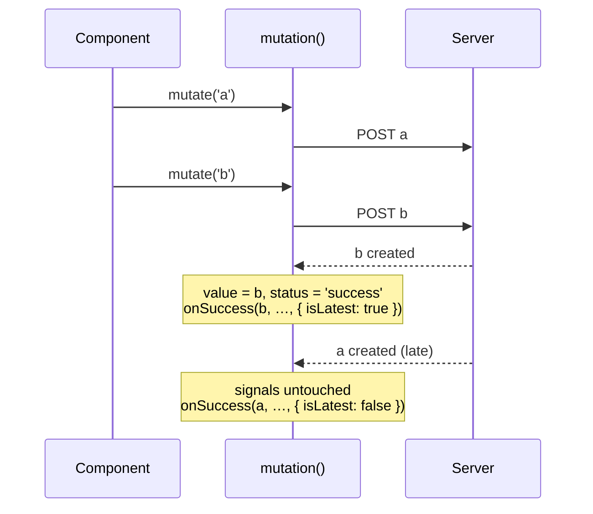

<div align="center">


# @ngsignal/mutation

[](https://github.com/ngsignal/mutation/actions/workflows/ci.yml)
[](https://github.com/ngsignal/mutation/actions/workflows/codeql.yml)
[](https://www.npmjs.com/package/@ngsignal/mutation)
[](./LICENSE)
[](https://securityscorecards.dev/viewer/?uri=github.com/ngsignal/mutation)

An Angular low-level Signal-based primitive for mutations (POST/PUT/DELETE).

[Live demo on StackBlitz](https://stackblitz.com/~/github.com/ErwanRaulo/ng-mutation-demo)

[Why](#why) · [Install](#install) · [Quick start](#quick-start) · [Features](#features) ·
[Working with resource](#working-with-resource) · [API](#api) ·
[rxMutation & httpMutation](#rxmutation--httpmutation) · [Design choices](#design-choices)

</div>

## Why
 
Angular provides `resource()` and `httpResource()` for reactive fetching,
but explicitly not for mutations:
 
> "resource is intended for _read_ operations, not operations which perform
> mutations. resource will cancel in-progress loads via the AbortSignal
> when destroyed or when a new request object becomes available, which
> could prematurely abort mutations."
> [Angular API reference](https://angular.dev/api/core/resource)
 
Today, handling a POST/PUT/DELETE means either manually overloading
`httpResource`, or hand-rolling the write in a service, where a `saving` flag is easy to get
wrong: on a double click, the first call to finish sets it back to `false` while the second one
is still in flight.
 
## Install
 
```bash
npm install @ngsignal/mutation
```
 
Requires Angular `^21.0.0` or `^22.0.0` (peer dependency).
 
## Quick start
 
```ts
import { Component, inject } from '@angular/core';
import { mutation } from '@ngsignal/mutation';
 
@Component({
  selector: 'app-todo',
  template: `
    <input #title />
 
    <button (click)="addTodo(title.value)" [disabled]="createTodo.isPending()">
      {{ createTodo.isPending() ? 'Saving…' : 'Add' }}
    </button>
 
    @if (createTodo.error(); as error) {
      <p role="alert">{{ error }}</p>
    }
  `,
})
export class NewTodoComponent {
  private readonly api = inject(TodoApi);
 
  readonly createTodo = mutation<string, Todo>({
    mutationFn: (title, abortSignal) => this.api.createTodo(title, abortSignal),
  });
 
  addTodo(title: string): void {
    this.createTodo.mutate(title);
  }
}
```
 
Using Observables or `HttpClient`? See [rxMutation & httpMutation](#rxmutation--httpmutation).
 
## Features

### Stale-response guarding
 
Calling `mutate()` again while one is already in flight does **not** abort the previous call, a
write may already have reached the server and be unsafe to cancel there, so both calls run to
completion independently. Only the last call's outcome is committed to `status`/`value`/`error`,
but each call still runs its [callbacks](#callbacks-onsuccess--onerror).


 
### Callbacks: onSuccess / onError
 
Run side effects (cache updates, navigation, toasts) right where the mutation is declared, in
addition to `await mutate(...)` at the call site.
 
```ts
const createTodo = mutation<string, Todo>({
  mutationFn: (title, signal) => api.createTodo(title, signal),
  onSuccess: (todo) => this.todos.update((list) => [...list, todo]),
  onError: (err) => this.toast.show(String(err)),
});
```
 
Callbacks run once for **every** call that settles, including a call superseded by a more recent
`mutate()`: its write happened on the server, so creating two todos quickly appends both. The
last argument tells calls apart, for side effects that should only follow the current one:
 
```ts
onSuccess: (todo, title, { isLatest }) => {
  this.todos.update((list) => [...list, todo]);
  if (isLatest) this.form.reset();
},
```
 
Calls aborted by `reset()` or by destroying the injection context run no callback.
 
### snapshot
 
`status`/`value`/`error` are three separate signals, so TypeScript can't narrow `value()` from
`status()` alone. `snapshot()` bundles them into one discriminated-union read for exhaustive
`@switch`/`switch` handling:
 
```ts
@let snap = createInvoice.snapshot();
@switch (snap.status) {
  @case ('success') { {{ snap.value.id }} }
  @case ('error') { {{ snap.error }} }
  @default { Idle or pending… }
}
```
 
`value` stays populated on `'pending'`/`'error'` too, since `mutation()` keeps the last known
value across those states (see [stale-response guarding](#stale-response-guarding)).
 
### hasValue guard
 
`value()` is `undefined` until the first success. `hasValue()` narrows it to `TOutput`:
 
```ts
const createInvoice = mutation<Order, Invoice>({
  mutationFn: (order, signal) => api.createInvoice(order, signal),
});
 
if (createInvoice.hasValue()) {
  downloadPdf(createInvoice.value());
}
```

For a mutation returning nothing (`TOutput` is `void`), `value()` stays undefined even after a
success: check `isSuccess()` instead.
 
### Also included
 
- **`mutate()`** returns a promise that settles like `mutationFn` does, for that call. Ignoring
  it (`(click)="save.mutate(x)"`) is safe: a failure never reports an unhandled rejection, and
  still shows in `error()`.
- **`reset()`** brings `status`/`value`/`error`/`input` back to their initial state and aborts
  any in-flight call(s).
- **`onSettled`** runs after `onSuccess` or `onError`, whichever fired; use it for cleanup that
  must happen either way (closing a modal, releasing a UI lock).
- **`input`** holds the input of the most recent `mutate()` call, from the moment it's called
  until the next `mutate()` or `reset()`.
- **`isPending` / `isIdle` / `isSuccess` / `isError`**: one boolean signal per `status()` value.
- **SSR support**: every in-flight mutation registers with Angular's `PendingTasks`, so
  `ApplicationRef.isStable` (and SSR rendering) waits for it, and releases it immediately on
  reset/destroy rather than waiting for a stale call to settle.
- **Custom injector**: pass `injector` to call `mutation()` outside of an injection context
  (e.g. factory functions).

### Concurrency

What happens to a second `mutate()` while a call is still in flight:

| `concurrency`   | Second `mutate()`                                                        | Typical use                                  |
| --------------- | ------------------------------------------------------------------------ | -------------------------------------------- |
| unset (default) | Runs right away, in parallel                                             | Independent writes (adding items to a list)  |
| `'queue'`       | Waits for the previous call, then runs: submission order is kept         | Writes that must reach the server in order (reordering, autosave) |
| `'drop'`        | Rejected at once (`'Dropped'`), `mutationFn` never runs, signals untouched | Double-submit protection (payment, form submit) |

In every mode, `status`/`value`/`error`/`input` reflect the most recently submitted call.

### Cancellations

Every cancellation rejects `mutate()` with a `DOMException` named `'AbortError'`, so
`error.name === 'AbortError'` catches them all. The message tells whether the write may have
reached the server, e.g. before rolling back an optimistic update:

| Cancelled by                                      | Message                           | Write sent?                    |
| ------------------------------------------------- | --------------------------------- | ------------------------------ |
| `concurrency: 'drop'`, a call already in flight   | `'Dropped'`                       | No, `mutationFn` never ran     |
| `mutate()` after the injection context is destroyed | `'Destroyed'`                   | No, `mutationFn` never ran     |
| `reset()`/destroy while queued (`'queue'`)        | `'Aborted'`                       | No, `mutationFn` never ran     |
| `reset()`/destroy while in flight                 | whatever `mutationFn` rejects with | **Maybe**: the request had left |

> [!WARNING]
> Aborting never undoes a write the server already received: `reset()` only stops the client
> from waiting for it.

 
## Working with resource
 
`mutation()` has no cache and won't touch a `resource()`/`httpResource()` for you. See
[docs/RECIPES.md](./docs/RECIPES.md):
 
- [Refreshing a resource after a mutation](./docs/RECIPES.md#refreshing-a-resource-after-a-mutation)
- [Optimistic updates with rollback](./docs/RECIPES.md#optimistic-updates)
- [Retrying writes](./docs/RECIPES.md#retrying-writes)
- [Using Observables and `HttpClient`](./docs/RECIPES.md#using-observables-and-httpclient)
 
## API
 
`mutation<TInput, TOutput, TError = unknown>(options)`
 
`TError` types `error()`/`onError`/`onSettled`; omit it and they stay `unknown`.
 
### Options
 
| Option        | Type                                                                          |
| ------------- | ------------------------------------------------------------------------------ |
| `mutationFn`  | `(input: TInput, abortSignal: AbortSignal) => Promise<TOutput>`                |
| `onSuccess?`  | `(output: TOutput, input: TInput, context: MutationCallbackContext) => void`   |
| `onError?`    | `(error: TError, input: TInput, context: MutationCallbackContext) => void`     |
| `onSettled?`  | `(output: TOutput \| undefined, error: TError \| undefined, input: TInput, context: MutationCallbackContext) => void` |
| `concurrency?`| `'queue' \| 'drop'`                                                            |
| `injector?`   | `Injector`                                                                      |
 
## rxMutation & httpMutation
 
`mutationFn` expects a `Promise`. For Observables, two variants mirror Angular's own
`rxResource()`/`httpResource()` split:
 
| Angular (reads) | Mutations          | Import from                      | You provide                                                          |
| --------------- | ------------------ | -------------------------------- | -------------------------------------------------------------------- |
| `rxResource`    | **`rxMutation`**   | `@ngsignal/mutation/rxjs-interop` | any Observable, e.g. an existing service: `(dto) => this.users.create(dto)` |
| `httpResource`  | **`httpMutation`** | `@ngsignal/mutation/http`         | a request description: `(dto) => ({ method: 'POST', url, body: dto })` |

Like Angular's own `@angular/core/rxjs-interop`, they live in secondary entry points: the main
`@ngsignal/mutation` entry never loads `rxjs` operators or `@angular/common/http`. They require
`rxjs` (6.5+ or 7, like Angular 21) and, for `httpMutation`, `@angular/common` — both declared as
optional peer dependencies.
 
`reset()` and destroying the injection context unsubscribe, which aborts an `HttpClient`
request. `httpMutation()` sends the request itself through `HttpClient`, so it also exposes
`uploadProgress`, `downloadProgress`, `statusCode` and `headers` signals.
 
- [Reusing an Observable-returning service](./docs/RECIPES.md#reusing-an-observable-returning-service)
- [Describing an HTTP request](./docs/RECIPES.md#describing-an-http-request)
- [Validating the response](./docs/RECIPES.md#validating-the-response)
- [Non-JSON responses](./docs/RECIPES.md#non-json-responses)
- [Upload progress](./docs/RECIPES.md#upload-progress)
- [Status code and headers](./docs/RECIPES.md#status-code-and-headers)
- [Requests that must outlive the component](./docs/RECIPES.md#requests-that-must-outlive-the-component)
 
## Design choices
 
Directly inspired by the internal structure of `resource.ts` in Angular core. See
[docs/ARCHITECTURE.md](./docs/ARCHITECTURE.md) for the implementation rationale and a
comparison with `@tanstack/angular-query-experimental`.
 
## Status & Stability
 
Experimental (`0.x`): minor releases may include breaking changes, called out in the
[CHANGELOG.md](./CHANGELOG.md). Pin an exact version to avoid surprises.
 
## Contributing
 
Issues and PRs are welcome, see [CONTRIBUTING.md](./CONTRIBUTING.md).
 
## License
 
MIT
 