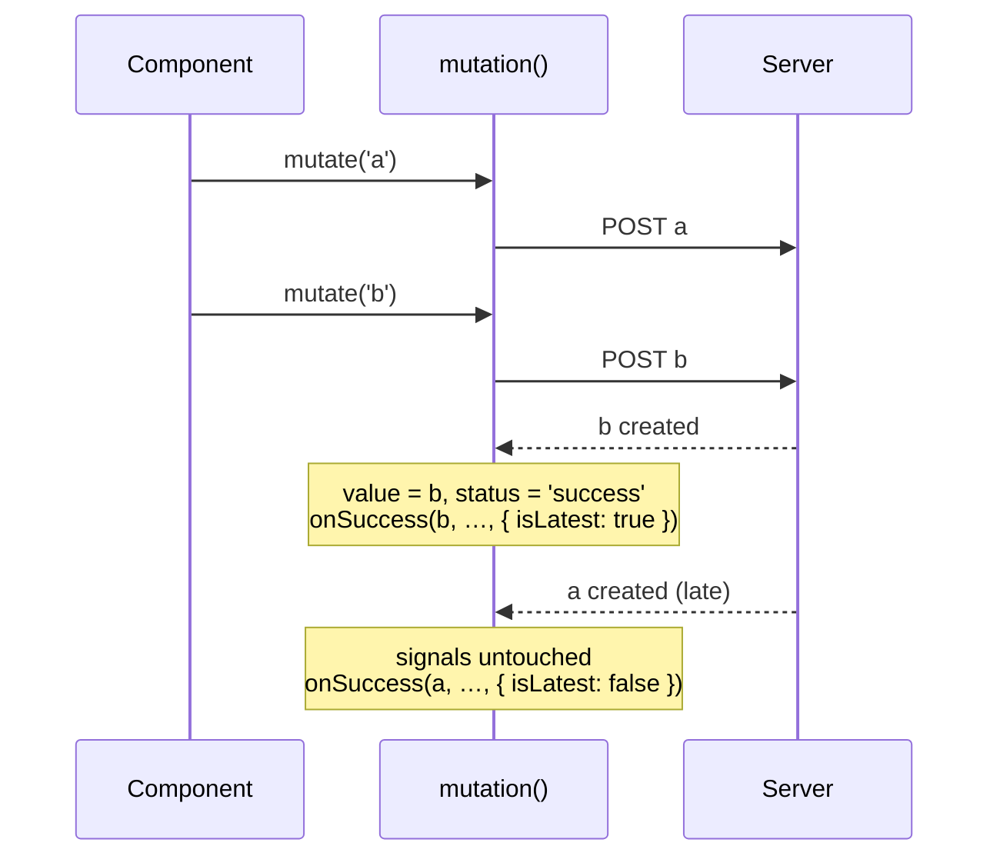

<div align="center">


# @ngsignal/mutation

[](https://github.com/ngsignal/mutation/actions/workflows/ci.yml)
[](https://github.com/ngsignal/mutation/actions/workflows/codeql.yml)
[](https://www.npmjs.com/package/@ngsignal/mutation)
[](./LICENSE)
[](https://securityscorecards.dev/viewer/?uri=github.com/ngsignal/mutation)
[](https://www.bestpractices.dev/projects/16728)

An Angular low-level Signal-based primitive for mutations (POST/PUT/DELETE).

<a href="https://ngsignal.github.io/mutation/"></a>
<a href="https://stackblitz.com/github/ngsignal/mutation/tree/demo/examples/demo"></a>

[Why](#why) · [Install](#install) · [Quick start](#quick-start) · [Features](#features) ·
[Recipes](#recipes) · [Public API](#public-api) ·
[rxMutation & httpMutation](#rxmutation--httpmutation) · [Design choices](#design-choices)

</div>

## Why
 
Angular provides `resource()` and its HTTP variant for reactive fetching,
but explicitly not for mutations:
 
> "resource is intended for _read_ operations, not operations which perform
> mutations. resource will cancel in-progress loads via the AbortSignal
> when destroyed or when a new request object becomes available, which
> could prematurely abort mutations."
> [Angular API reference](https://angular.dev/api/core/resource)
 
Today, handling a POST/PUT/DELETE means either bending `httpResource` to the job, or
hand-rolling the write in a service, where a "saving" flag is easy to get wrong: on a double
click, the first call to finish clears it while the second one is still in flight.
 
## Install
 
```bash
npm install @ngsignal/mutation
```
 
Requires Angular 21 or 22 (peer dependency).
 
## Quick start
 
```ts
import { Component, inject } from '@angular/core';
import { mutation } from '@ngsignal/mutation';
 
@Component({
  selector: 'app-todo',
  template: `
    <input #title />
 
    <button (click)="addTodo(title.value)" [disabled]="createTodo.isPending()">
      {{ createTodo.isPending() ? 'Saving…' : 'Add' }}
    </button>
 
    @if (createTodo.error(); as error) {
      <p role="alert">{{ error }}</p>
    }
  `,
})
export class NewTodoComponent {
  private readonly api = inject(TodoApi);
 
  readonly createTodo = mutation<string, Todo>({
    mutationFn: (title, abortSignal) => this.api.createTodo(title, abortSignal),
  });
 
  addTodo(title: string): void {
    this.createTodo.mutate(title);
  }
}
```
 
Using Observables or `HttpClient`? See [rxMutation & httpMutation](#rxmutation--httpmutation).
 
## Features

### Stale-response guarding
 
Calling `mutate()` again while a call is in flight does **not** abort the previous one: its write
may already have reached the server. Both calls run to completion. Only the latest call's outcome
shows in the state signals (status, value, error, input), but each call still runs its
[callbacks](#callbacks-onsuccess--onerror).


 
### Callbacks: onSuccess / onError
 
Run side effects (cache updates, navigation, toasts) right where the mutation is declared, in
addition to `await mutate(...)` at the call site.
 
```ts
readonly createTodo = mutation<string, Todo>({
  mutationFn: (title, abortSignal) => this.api.createTodo(title, abortSignal),
  onSuccess: (todo) => this.todos.update((list) => [...list, todo]),
  onError: (err) => this.toast.show(String(err)),
});
```
 
Since every call runs its callbacks ([see above](#stale-response-guarding)), creating two todos
quickly appends both. `isLatest` tells calls apart, for side effects that should only follow the
current one:
 
```ts
onSuccess: (todo, title, { isLatest }) => {
  this.todos.update((list) => [...list, todo]);
  if (isLatest) this.form.reset();
},
```
 
Calls aborted by a reset or by destroying the injection context run no callback.
 
### snapshot
 
Status, value and error are three separate signals, so TypeScript can't narrow the value from
the status alone. `snapshot()` reads them together as one discriminated union, ready for an
exhaustive `@switch`:
 
```ts
@let snap = createInvoice.snapshot();
@switch (snap.status) {
  @case ('success') { {{ snap.value.id }} }
  @case ('error') { {{ snap.error }} }
  @default { Idle or pending… }
}
```
 
The value is kept while pending and after an error: the last known value stays until a new
success or a reset (see [stale-response guarding](#stale-response-guarding)).
 
### hasValue guard
 
The value is undefined until the first success. `hasValue()` narrows its type:
 
```ts
const createInvoice = mutation<Order, Invoice>({
  mutationFn: (order, abortSignal) => api.createInvoice(order, abortSignal),
});
 
if (createInvoice.hasValue()) {
  downloadPdf(createInvoice.value());
}
```

For a mutation that returns nothing, the value stays undefined even after a success: check
`isSuccess()` instead.

### pendingInputs

The input signal only follows the latest call. `pendingInputs()` lists the inputs of
every call still in flight (superseded and queued ones included), so one mutation shared by a
list can disable each row being written:

```html
<button (click)="deleteRow.mutate(row.id)" [disabled]="deleteRow.pendingInputs().includes(row.id)">
  Delete
</button>
```

`isPending()` is shorthand for `pendingInputs().length > 0`, like `submitting()` in Signal Forms.
It stays true after a success or error while a superseded call is still running. A reset or
destroy turns it false. A call leaves the list before its callbacks run: an `onSuccess` sees
only the other calls. `pendingInputs()` also gives
[optimistic updates without a rollback](./docs/RECIPES.md#optimistic-updates).
 
### Also included
 
- **`mutate()`** returns a promise that settles with the call's outcome. Ignoring it, as in
  `(click)="save.mutate(x)"`, is safe: a failure never reports an unhandled rejection, and
  still shows in the error signal.
- **`reset()`** brings the state signals back to their initial state and aborts every call in
  flight: see [Cancellations](#cancellations).
- **`onSettled`** runs after the success or error callback, whichever fired; use it for cleanup
  that must happen either way (closing a modal, releasing a UI lock).
- **`input`** holds the input of the latest call, from the moment it's made until the next call
  or reset.
- **`isIdle` / `isSuccess` / `isError`**: one boolean per status. `isPending` is true while any
  call is in flight, so it can stay true after the status settled: see
  [pendingInputs](#pendinginputs).
- **SSR support**: every call in flight registers with Angular's `PendingTasks`, so the app
  isn't stable (and SSR doesn't render) until it settles. A reset or destroy releases it at once
  rather than waiting for a stale call.
- **Custom injector**: pass `injector` to create a mutation outside an injection context
  (e.g. factory functions).

### Concurrency

What happens to a second call while one is still in flight:

| `concurrency`   | Second `mutate()`                                                        | Typical use                                  |
| --------------- | ------------------------------------------------------------------------ | -------------------------------------------- |
| `'parallel'` (default) | Runs right away, in parallel                                      | Independent writes (adding items to a list)  |
| `'queue'`       | Waits for the previous call, then runs: submission order is kept         | Writes that must reach the server in order (reordering, autosave) |
| `'drop'`        | Rejected at once (`'Dropped'`), `mutationFn` never runs, signals untouched | Double-submit protection (payment, form submit) |
| a `mutationQueue()` | Waits for the previous call of every mutation given the same queue   | Different writes to the same data (rename, then delete) |
| `{ queue, key }` | Waits for the previous call with the same key; other keys run at once. A call on the same queue without a key waits for every key | Order per entity (autosave of several documents) |

In every mode, the state signals reflect the most recent call of the mutation itself. Sharing a
queue works the same with `mutation()`, `rxMutation()` and `httpMutation()`: see
[Ordering writes across mutations](./docs/RECIPES.md#ordering-writes-across-mutations).

In queue mode, a call made after a reset still waits for an aborted call already in flight to
settle, so writes stay in order. Pass the abort signal on to your request (the RxJS and HTTP
variants do) so the queue frees up at once.

### Cancellations

Every cancellation rejects the call with an `AbortError`, so `error.name === 'AbortError'`
catches them all. The message tells whether the write may have
reached the server, e.g. before rolling back an optimistic update:

| Cancelled by                                      | Message                           | Write sent?                    |
| ------------------------------------------------- | --------------------------------- | ------------------------------ |
| `concurrency: 'drop'`, a call already in flight   | `'Dropped'`                       | No, `mutationFn` never ran     |
| `mutate()` after the injection context is destroyed | `'Destroyed'`                   | No, `mutationFn` never ran     |
| `reset()`/destroy while queued (`'queue'`)        | `'NotStarted'`, at once           | No, `mutationFn` never ran     |
| `reset()`/destroy while in flight                 | `'Aborted'`, at once              | **Maybe**: the request had left |

`mutate()` rejects at once, like `fetch()`, even if `mutationFn` ignores the signal or rejects
with its own error: pass the signal on anyway, so the request itself stops.

`wasNeverSent(error)` is true for the first three rows, where `mutationFn` never ran: e.g. roll
back an optimistic update only then. HTTP status codes are yours to check.

```ts
this.deleteUser.mutate(user).catch((error) => {
  if (wasNeverSent(error)) this.users.update((users) => [...users, user]);
});
```

> [!WARNING]
> Aborting never undoes a write the server already received: a reset only stops the client
> from waiting for it.

 
## Recipes
 
The library stays a primitive: no cache, no retry, and it won't update your resources for you.
The [recipes](./docs/RECIPES.md) show the usual patterns:
 
- [Refreshing a resource after a mutation](./docs/RECIPES.md#refreshing-a-resource-after-a-mutation)
- [Optimistic updates with rollback](./docs/RECIPES.md#optimistic-updates)
- [Choosing settings by HTTP method](./docs/RECIPES.md#choosing-settings-by-http-method)
- [Retrying writes](./docs/RECIPES.md#retrying-writes)
- [Submitting a Signal Form](./docs/RECIPES.md#submitting-a-signal-form)
- [Testing a component](./docs/RECIPES.md#testing-a-component)
- Observables and `HttpClient`: [rxMutation & httpMutation](#rxmutation--httpmutation)
 
## Public API
 
`mutation<TInput, TOutput, TError = unknown>(options)`
 
`TError` types the error signal and the error callbacks; omit it and they stay `unknown`. It is
an assertion, not a check: they receive whatever `mutationFn` rejects with, an abort error
included.
 
### Options
 
| Option        | Type                                                                          |
| ------------- | ------------------------------------------------------------------------------ |
| `mutationFn`  | `(input: TInput, abortSignal: AbortSignal) => Promise<TOutput>`                |
| `onSuccess?`  | `(output: TOutput, input: TInput, context: MutationCallbackContext) => void`   |
| `onError?`    | `(error: TError, input: TInput, context: MutationCallbackContext) => void`     |
| `onSettled?`  | `(output: TOutput \| undefined, error: TError \| undefined, input: TInput, context: MutationCallbackContext) => void` |
| `concurrency?`| `'parallel' \| 'queue' \| 'drop' \| MutationQueue \| { queue, key }` (default `'parallel'`) |
| `injector?`   | `Injector`                                                                      |
| `debugName?`  | `string`: names the state signals in Angular DevTools (`'save'` → `save.status`) |

### Returned `MutationRef<TInput, TOutput, TError>`

| Member            | Type                                | Follows                                    |
| ----------------- | ----------------------------------- | ------------------------------------------ |
| `status`          | `Signal<'idle' \| 'pending' \| 'success' \| 'error'>` | the latest call               |
| `value`           | `Signal<TOutput \| undefined>`      | the latest success, until `reset()`        |
| `error`           | `Signal<TError \| undefined>`       | the latest call                            |
| `input`           | `Signal<TInput \| undefined>`       | the latest call                            |
| `isIdle` / `isSuccess` / `isError` | `Signal<boolean>`  | `status()`                                 |
| `isPending`       | `Signal<boolean>`                   | every call in flight                       |
| `pendingInputs`   | `Signal<readonly TInput[]>`         | every call in flight                       |
| `snapshot`        | `Signal<MutationSnapshot<TOutput, TError>>` | the latest call                    |
| `hasValue()`      | type guard: `value()` is `TOutput`  | `value()`                                  |
| `mutate(input)`   | `Promise<TOutput>`                  | this call                                  |
| `reset()`         | `void`                              | aborts every call in flight                |

`MutationRef` is meant to be used, not implemented: a minor version may add members.

`TInput` defaults to `void`: a `mutationFn` (or `request`) without parameters gives a
`mutate()` that takes no argument.
 
## rxMutation & httpMutation
 
`mutationFn` returns a promise. For Observables, two variants mirror Angular's split between
its RxJS and HTTP resources:
 
| Angular (reads) | Mutations          | Import from                      | You provide                                                          |
| --------------- | ------------------ | -------------------------------- | -------------------------------------------------------------------- |
| `rxResource`    | **`rxMutation`**   | `@ngsignal/mutation/rxjs-interop` | any Observable, e.g. an existing service: `(dto) => this.users.create(dto)` |
| `httpResource`  | **`httpMutation`** | `@ngsignal/mutation/http`         | a request description: `(dto) => ({ method: 'POST', url, body: dto })` |

Like Angular's own RxJS interop, they live in secondary entry points, so the main entry never
loads RxJS or Angular's HTTP client. They need RxJS (6.5+ or 7, like Angular 21) and, for the
HTTP variant, `@angular/common`: both are optional peer dependencies.
 
A call resolves with the last value, once the Observable completes. A reset or destroying the
injection context unsubscribes, which aborts an `HttpClient` request.
`httpMutation()` sends the request itself, so it also exposes the status code and headers as
signals, plus upload and download progress when the request sets `reportProgress: true`. Upload
progress needs the XHR backend: see [Upload progress](./docs/RECIPES.md#upload-progress).
 
- [Reusing an Observable-returning service](./docs/RECIPES.md#reusing-an-observable-returning-service)
- [Describing an HTTP request](./docs/RECIPES.md#describing-an-http-request)
- [Validating the response](./docs/RECIPES.md#validating-the-response)
- [Non-JSON responses](./docs/RECIPES.md#non-json-responses)
- [Upload progress](./docs/RECIPES.md#upload-progress)
- [Status code and headers](./docs/RECIPES.md#status-code-and-headers)
- [Requests that must outlive the component](./docs/RECIPES.md#requests-that-must-outlive-the-component)
 
## Design choices
 
Directly inspired by the internals of Angular's `resource()`. See
[docs/ARCHITECTURE.md](./docs/ARCHITECTURE.md) for the implementation rationale and a
comparison with TanStack Query and NgRx Toolkit.
 
## Status & Stability
 
Experimental (0.x): minor releases may include breaking changes, called out in the
[CHANGELOG.md](./CHANGELOG.md). Pin an exact version to avoid surprises. What is planned
before 1.0 is in the [roadmap](./docs/ROADMAP.md).
 
## Contributing
 
Issues and PRs are welcome, see [CONTRIBUTING.md](./CONTRIBUTING.md).
 
## License
 
MIT
 